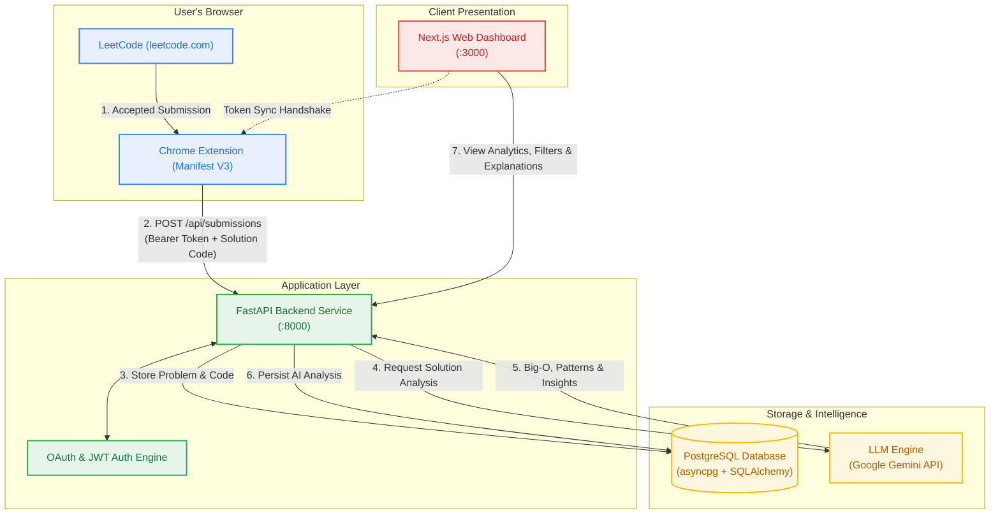
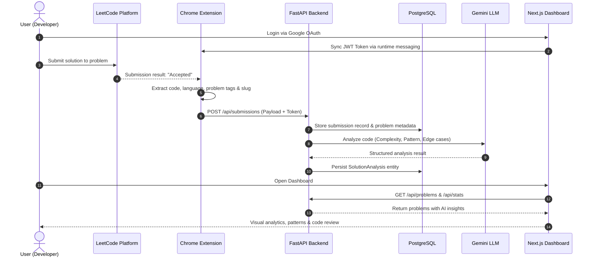

# ⚡ LeetTracker (LeetO)

<div align="center">

**Automated LeetCode Submission Tracking & AI Solution Intelligence System**

[](https://fastapi.tiangolo.com)
[](https://nextjs.org/)
[](https://www.postgresql.org/)
[](https://ai.google.dev/)
[](https://developer.chrome.com/docs/extensions/mv3/)

</div>

---

## 📌 Overview

**LeetTracker** is an end-to-end platform designed to automatically capture your successful LeetCode submissions, perform deep automated algorithmic analysis using Large Language Models (LLM), and provide an interactive web dashboard for monitoring your progress and reviewing optimization insights.

Gone are the days of manually copying code into notes. Solve problems on LeetCode as you normally do—**LeetTracker handles the rest**.

---

## 🏗️ System Architecture & Workflow

The platform consists of four interconnected components designed for low latency, secure authentication, and scalable asynchronous processing:



---

## 🔄 End-to-End Sequence Flow



---

## 🧩 Core Components

| Component | Technology | Primary Responsibilities |
| :--- | :--- | :--- |
| **Chrome Extension** | Manifest V3, JavaScript | • Injected into `leetcode.com/problems/*`<br>• Detects accepted submissions in real time<br>• Extracts problem title, difficulty, tags, language, and code<br>• Syncs authentication token directly with the web frontend<br>• Relays solution payload to backend API |
| **FastAPI Backend** | Python 3.10+, FastAPI, Uvicorn | • Secure Google OAuth2 login & JWT session verification<br>• Asynchronous REST API routing<br>• Data validation and schema sanitization via Pydantic<br>• Manages submission intake and triggers AI review pipeline |
| **PostgreSQL + LLM** | SQLAlchemy 2 (Async), asyncpg, Gemini API | • **PostgreSQL**: Relational storage for users, problems, topics, patterns, submissions, and analyses<br>• **LLM Engine**: Automatically derives Big-O (Time & Space) complexity, identifies algorithmic patterns (Two Pointers, DP, Monotonic Stack), highlights pitfalls, and provides optimal alternative approaches |
| **Next.js Dashboard** | Next.js 15, React, TypeScript, Tailwind CSS | • Hosted modern responsive user interface<br>• Filter problems by difficulty, topic tags, and algorithmic pattern<br>• Detailed submission review drawer featuring AI breakdown<br>• One-click browser extension token synchronization |

---

## ✨ Key Features

- **Zero-Friction Automated Tracking**: No copy-pasting or manual entry. Solve problems naturally on LeetCode; the extension detects accepted submissions seamlessly.
- **Deep Algorithmic Intelligence**: Automatically tags underlying algorithmic techniques (e.g. *Sliding Window*, *Binary Search*, *DFS/BFS*, *Greedy*) and rates time/space complexity.
- **Actionable Optimization Insights**: The AI breaks down trade-offs, detects edge case vulnerabilities, and provides cleaner or more idiomatic code recommendations.
- **Progress & Performance Analytics**: Filter your past solutions by patterns, languages, difficulty levels, and topics to quickly target weak spots before technical interviews.
- **Secure Architecture**: Cookie & Bearer JWT-based authentication pipeline connecting the dashboard, extension, and backend API securely.

---

## 📁 Repository Directory Structure

```text
LeetTracker/
├── Extension/              # Chrome Extension (Manifest V3)
│   ├── manifest.json       # Extension configuration & permissions
│   ├── background.js       # Background service worker & API dispatcher
│   ├── content.js          # LeetCode DOM watcher & submission extractor
│   ├── popup.html          # Extension status popup UI
│   └── popup.js            # Popup interaction script
│
├── Backend/                # FastAPI Application & AI Service
│   ├── app/
│   │   ├── ai/             # Gemini LLM prompts, service & schemas
│   │   ├── auth/           # OAuth configuration, JWT & security helpers
│   │   ├── controllers/    # Business logic layer
│   │   ├── db/             # Database connection & async session factory
│   │   ├── models/         # SQLAlchemy DB models (Problem, Submission, etc.)
│   │   ├── routes/         # API Routers (auth, problems, stats, submissions)
│   │   ├── schemas/        # Pydantic validation models
│   │   └── main.py         # Application entry point & CORS configuration
│   ├── requirements.txt    # Python dependencies
│   └── .env                # Backend environment configuration
│
├── frontend/               # Next.js 15 Web Dashboard
│   ├── src/
│   │   ├── app/            # App Router pages and layout
│   │   ├── components/     # Reusable UI components & dialogs
│   │   ├── lib/            # API client, auth & utility helpers
│   │   └── types/          # TypeScript interface definitions
│   ├── package.json        # Frontend scripts and packages
│   └── .env.example        # Frontend environment template
│
└── Readme.md               # Project documentation
```

---

## 🚀 Getting Started

### 1. Prerequisites

- **Python 3.10+**
- **Node.js 18+** & **npm**
- **PostgreSQL** instance (local or hosted, e.g., Neon, Supabase, Railway)
- **Google Cloud Console** credentials (for Google OAuth)
- **Google Gemini API Key** (from [Google AI Studio](https://aistudio.google.com/))
- **Google Chrome** browser

---

### 2. Backend Setup (FastAPI)

1. Navigate to the `Backend` directory:
   ```bash
   cd Backend
   ```

2. Create and activate a Python virtual environment:
   ```bash
   # Windows (PowerShell)
   python -m venv venv
   .\venv\Scripts\Activate.ps1

   # Linux / macOS
   python3 -m venv venv
   source venv/bin/activate
   ```

3. Install dependencies:
   ```bash
   pip install -r requirements.txt
   ```

4. Configure environment variables (`Backend/.env`):
   ```env
   # Database
   DB_URI=postgresql+asyncpg://<username>:<password>@<host>:<port>/<database_name>

   # Security & Auth
   JWT_SECRET=your_super_secret_jwt_key_at_least_32_characters_long
   FRONTEND_ORIGINS=http://localhost:3000

   # Google OAuth
   GOOGLE_CLIENT_ID=your_google_client_id.apps.googleusercontent.com
   GOOGLE_CLIENT_SECRET=your_google_client_secret
   GOOGLE_REDIRECT_URI=http://localhost:8000/api/auth/google/callback

   # LLM Analysis
   GEMINI_API_KEY=your_gemini_api_key
   ```

5. Run the FastAPI development server:
   ```bash
   uvicorn app.main:app --reload --port 8000
   ```
   *The API will be available at `http://localhost:8000`. You can inspect interactive Swagger documentation at `http://localhost:8000/docs`.*

---

### 3. Frontend Setup (Next.js Dashboard)

1. Navigate to the `frontend` directory:
   ```bash
   cd ../frontend
   ```

2. Install dependencies:
   ```bash
   npm install
   ```

3. Configure environment variables (`frontend/.env.local`):
   ```env
   NEXT_PUBLIC_API_BASE_URL=http://localhost:8000
   NEXT_PUBLIC_SITE_URL=http://localhost:3000
   NEXT_PUBLIC_CHROME_EXTENSION_ID=<extension_id_from_chrome>
   ```

4. Run the development server:
   ```bash
   npm run dev
   ```
   *Open `http://localhost:3000` in your browser.*

---

### 4. Chrome Extension Setup

1. Open Google Chrome and navigate to:
   ```text
   chrome://extensions/
   ```
2. Enable **Developer mode** (toggle in the top-right corner).
3. Click **Load unpacked** and select the `Extension/` directory from this repository.
4. Note your extension's **ID** (e.g., `abcdefghijklmnop...`).
5. (Optional) Update `NEXT_PUBLIC_CHROME_EXTENSION_ID` in your `frontend/.env.local` to allow automatic token synchronization between the web app and extension.
6. In `Extension/manifest.json`, verify that `http://localhost:3000/*` and `http://127.0.0.1:8000/*` match your local development URLs.

---

## 📡 Key API Endpoints

| Method | Endpoint | Description |
| :--- | :--- | :--- |
| `GET` | `/health` | Healthcheck endpoint |
| `POST` | `/api/submissions` | Intake LeetCode submission & initiate AI review |
| `GET` | `/api/problems` | List tracked problems with pagination and filters |
| `GET` | `/api/problems/{id}` | Retrieve individual problem details and AI analyses |
| `GET` | `/api/stats` | Aggregate metrics (easy/med/hard counts, pattern breakdown) |
| `GET` | `/api/auth/google` | Initiate Google OAuth login flow |
| `GET` | `/api/auth/google/callback` | OAuth callback & session token creation |

---

## 🛡️ Security & Privacy

- **Minimal Permissions**: The Chrome extension only requests permission on `https://leetcode.com/*` and your specified API host.
- **Protected Credentials**: Access tokens are stored using Chrome's secure storage API (`TRUSTED_CONTEXTS`) and never exposed to unprivileged webpage scripts.
- **Strict CORS**: The FastAPI server allows requests exclusively from verified frontend origins and designated browser extension contexts.

---

## 📄 License

This project is licensed under the [MIT License](LICENSE).
